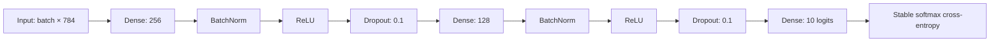
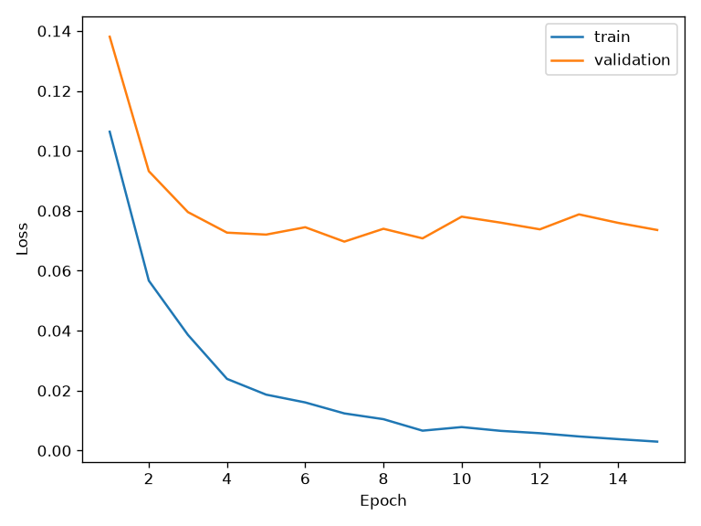
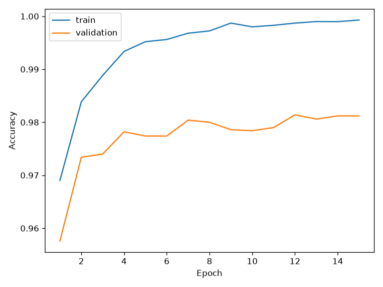
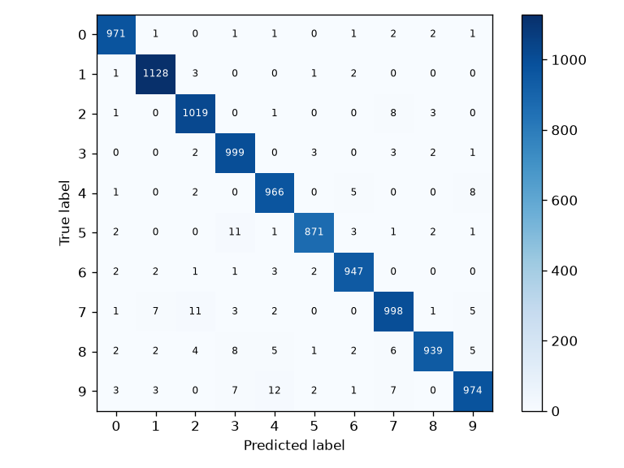
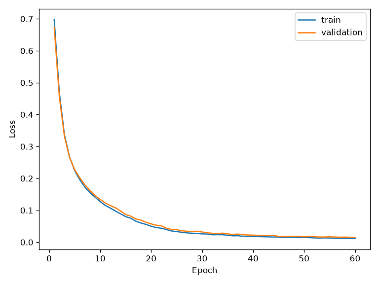
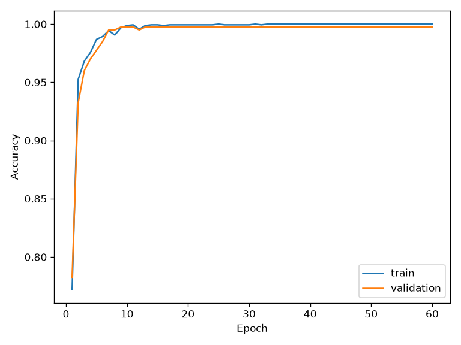
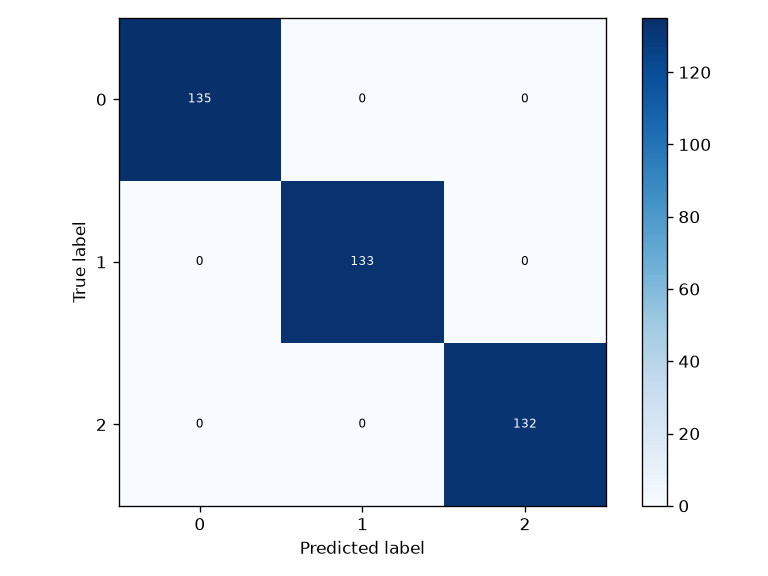

# Neural Network from Scratch

An educational Multi-Layer Perceptron implemented with **Python and NumPy**.
This is a learning project for understanding deep learning from first principles:
every gradient is written by hand, with no PyTorch, TensorFlow, Keras, or automatic differentiation.
Matplotlib only draws plots; pytest only runs tests.

## What you can learn

- Dense layers, ReLU, stable Sigmoid and Softmax, cross-entropy and MSE.
- Manual forward propagation and backpropagation with numerical gradient checks.
- SGD, SGD with momentum, and Adam with bias correction.
- He/Xavier initialization, L2 weight regularization, inverted dropout, and batch normalization.
- Mini-batch training, exponential learning-rate decay, early stopping, and best-model restoration.
- Reproducible experiments, checkpoint save/load, and held-out evaluation.

## Architecture

The MNIST experiment uses flattened 28×28 grayscale images:



The synthetic experiment uses a 2 → 64 → 64 → 3 network on three interleaved spirals.
It uses batch normalization and disables dropout.

## Installation

Tested with Python 3.12. Use Python 3.11 or newer with compatible dependency wheels.
Run these commands from the repository root:

```bash
python -m venv .venv
source .venv/bin/activate
python -m pip install -r requirements.txt
python -m pytest -q
```

On Windows, activate with `.venv\Scripts\activate`.
To avoid excessive BLAS thread overhead on small matrices, the measured runs use
`OPENBLAS_NUM_THREADS=2`. Exact floating-point results can vary across platforms.

## Run experiments

```bash
OPENBLAS_NUM_THREADS=2 python -m experiments.train --dataset synthetic --epochs 60 --seed 42
OPENBLAS_NUM_THREADS=2 python -m experiments.train --dataset mnist --epochs 35 --seed 42
```

MNIST downloads automatically over HTTPS from Google's CVDF mirror, falling back
to the `fgnt/mnist` GitHub mirror if unavailable. The four compressed IDX files
are checked against original MNIST MD5 hashes, then validated for format and size.
MD5 here detects distribution corruption; HTTPS supplies transport authentication.
Network access to either source is required on the first run. Data is cached in
`data/mnist/` and excluded from Git. MNIST comes from Yann LeCun, Corinna Cortes,
and Christopher Burges; see [the original dataset description](https://yann.lecun.com/exdb/mnist/).

The 60,000 training examples are shuffled with a fixed seed into 55,000 training
and 5,000 validation examples. The official 10,000-example test set is evaluated
after validation-based model selection. Pixel values are scaled to [0, 1].
No augmentation, pretrained features, GPU kernels, or test-set tuning is used.

Each run writes `metrics.json`, loss/accuracy curves, a confusion matrix, and
`model.npz` under `results/<dataset>/`. Checkpoints and datasets are ignored by Git;
metrics and small plots are retained. Rerunning the same dataset replaces its outputs.
Training metrics are inference-mode metrics on the entire training split after each
epoch. Loss curves show data cross-entropy; the separate `l2_penalty` metric records
regularization. Early stopping monitors validation cross-entropy with patience 8
and restores the best parameters and batch-normalization running statistics.

## The mathematics

Examples occupy rows. For a batch of B examples, an input width D, and output width H:

$$X\in\mathbb{R}^{B\times D},\quad W\in\mathbb{R}^{D\times H},\quad b\in\mathbb{R}^{H}$$

A dense layer computes $Z=XW+b$, broadcasting the bias across rows. Hidden layers
apply $\operatorname{ReLU}(Z)=\max(0,Z)$. He initialization uses variance $2/D$ for
ReLU layers; the final layer uses Xavier variance $2/(D+H)$.

For logits $z$ and class label $y$, let $m=\max_j z_j$. Cross-entropy is computed directly:

$$\ell(z,y)=\log\sum_j e^{z_j-m}-(z_y-m).$$

Subtracting the maximum prevents exponential overflow; computing the log-sum-exp
avoids taking the logarithm of a probability rounded to zero. Softmax produces
$p_j=e^{z_j-m}/\sum_k e^{z_k-m}$ and the fused loss derivative is
$\partial L/\partial z=(p-\operatorname{onehot}(y))/B$.

If $G=\partial L/\partial Z$, dense backpropagation follows the chain rule:

$$\frac{\partial L}{\partial W}=X^T G,\qquad
\frac{\partial L}{\partial b}=\sum_{i=1}^{B}G_i,\qquad
\frac{\partial L}{\partial X}=GW^T.$$

ReLU passes gradients only where its input was positive. Sigmoid uses
$\sigma(x)(1-\sigma(x))$. Softmax implements a Jacobian-vector product, avoiding
a full Jacobian matrix. MSE averages squared errors across all elements and has
gradient $2(\hat y-y)/\operatorname{size}(y)$.

Numerical checks compare manual derivatives with central differences
$[f(\theta+\epsilon)-f(\theta-\epsilon)]/(2\epsilon)$ using $\epsilon=10^{-5}$.
Checks cover layer inputs and parameters, both losses, and a complete network with L2.

## Optimizers and regularization

| Method | Update or effect |
|---|---|
| SGD | Subtract learning rate × gradient |
| Momentum | Accumulate $v\leftarrow\mu v+g$, then subtract $\eta v$ |
| Adam | Bias-correct first and second gradient moments; adapt each parameter's step |
| L2 | Add $\lambda\lVert W\rVert^2/2$ to the objective and $\lambda W$ to weight gradients; biases and batch-norm parameters are excluded |
| Dropout | Randomly zero activations during training and scale survivors by $1/(1-p)$; disabled at inference |
| Batch normalization | Normalize batch features, learn scale/shift, and retain exponential running statistics for inference |
| LR scheduling | Multiply the learning rate by 0.97 after each epoch |

The example uses Adam with initial learning rate 0.001, batch size 128, and L2 0.00001.
To explore SGD, replace `Adam()` in the experiment with `SGD(lr=0.05)` or
`SGD(lr=0.05, momentum=0.9)` and import it from `nn.optimizers`.

## Save and load

```python
# Construct the same Sequential architecture first.
model.save("checkpoint.npz")
model.load("checkpoint.npz")
logits = model.forward(images)  # inference mode is the default
predictions = logits.argmax(axis=1)
```

Files contain arrays only and load with `allow_pickle=False`. Keys and shapes are
validated. Checkpoints include batch-normalization statistics, but not optimizer
moments, RNG state, or architecture metadata: they support inference, not exact
training resumption. Every experiment verifies predictions survive a save/load round trip.

## Project structure

```text
nn/
  layers.py          Dense, dropout, batch normalization
  activations.py     ReLU, Sigmoid, Softmax
  losses.py          Fused cross-entropy, MSE
  optimizers.py      SGD/momentum and Adam
  model.py           Sequential composition and checkpoints
  training.py        Training, evaluation, early stopping, LR decay
  data.py            Synthetic spirals and validated MNIST loading
  visualization.py   Curves and annotated confusion matrix
experiments/train.py Reproducible command-line experiments
tests/               Gradients, stability, optimizers, checkpoints, training
results/             Actual metrics and example plots
```

## Results

Measured results are recorded below after running the experiments; JSON files
include split sizes, seed, architecture, NumPy version, elapsed time, and epoch history.

Measured on CPU with Python 3.12.14, seed 42 and two OpenBLAS threads.

| Dataset | Test examples | Epochs run | Selected epoch | Test accuracy | Test cross-entropy |
|---|---:|---:|---:|---:|---:|
| Synthetic spirals | 400 | 60 | 59 | 100.00% | 0.01236 |
| MNIST | 10,000 | 15 | 7 | 98.12% | 0.06347 |

MNIST stopped early after 15 epochs; its checkpoint was selected using validation
loss, not test accuracy. These are single-seed measurements, not guarantees.
The synthetic split has 1,600 training and 400 validation examples.
All 18 unit tests passed, including central-difference gradient checks. Both
experiments completed and verified checkpoint round trips.

[MNIST metrics](results/mnist/metrics.json) · [Synthetic metrics](results/synthetic/metrics.json)

### MNIST





### Synthetic spirals






## Future improvements

Add exact optimizer/RNG checkpoint resumption, richer experiment configuration,
learning-rate schedules such as cosine decay, and training-only image augmentation.
A convolutional network would be a separate educational extension. This compact
implementation favors clarity over production-scale performance and input validation.

## License

MIT; see [LICENSE](LICENSE).
